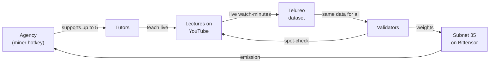

<div align="center">

<picture>
  <source media="(prefers-color-scheme: dark)" srcset="docs/assets/ttedu-symbol-dark.svg">
  
</picture>

# **TTedu** <!-- omit in toc -->

### Bittensor subnet 35, the incentive layer for teaching <!-- omit in toc -->

[](https://github.com/telureo/ttedu-subnet/actions/workflows/ci.yml)
[](LICENSE)
[](pyproject.toml)
[](https://github.com/opentensor/bittensor)

[Leaderboard](https://subnet.telureo.com) • [Telureo](https://telureo.com) • [Docs](https://docs.telureo.com) • [Whitepaper](https://docs.telureo.com/whitepaper/) • [X](https://x.com/TTeduSubnet) • [taostats](https://taostats.io/subnets/35)

</div>

---

- [Introduction](#introduction)
- [How it works](#how-it-works)
- [Incentive mechanism](#incentive-mechanism)
- [Repository layout](#repository-layout)
- [Installation](#installation)
- [Run an agency (miner)](#run-an-agency-miner)
- [Run a validator](#run-a-validator)
- [Trust](#trust)
- [Roadmap](#roadmap)
- [Contributing](#contributing)
- [Links](#links)
- [License](#license)

---

## Introduction

TTedu is the Bittensor subnet behind [Telureo](https://telureo.com), a platform for free live education. Tutors teach live lectures on Telureo's YouTube channels, and anyone can watch them for free.

On TTedu, **a miner is a tutor agency**. Each miner hotkey supports up to 5 tutors. **Validators** score every agency by the live audience its tutors' lectures attract, and the network rewards each agency by its share.

So the way to earn on TTedu is to find good teachers and help them teach lectures that people choose to watch live.

This repository holds everything agencies and validators run or may want to check: the incentive rules, the data formats, and the `ttedu` command line.

## How it works



1. An agency registers a hotkey on subnet 35 and brings tutors to Telureo.
2. Its tutors book and teach live lectures on Telureo's YouTube channels.
3. YouTube reports each lecture's live watch-minutes. Telureo collects them and serves them to validators as one dataset.
4. Every validator scores that dataset with the code in this repository, checks numbers against YouTube, and sets weights.
5. The chain pays each agency by the weight validators agree on.

## Incentive mechanism

The full rules, with a worked example, are in [docs/incentive_mechanism.md](docs/incentive_mechanism.md). In short:

- **Only live viewing counts.** The measure is YouTube's LIVE `estimatedMinutesWatched` for the lecture. Replays never count, and there is no cap.
- **Every lecture gets the same 72 hours.** Telureo starts checking YouTube 48 hours after a lecture actually ends, every 30 minutes. YouTube's first answer opens the lecture's 72-hour scoring window, however late that answer comes.
- **The score is YouTube's latest number.** During the 72 hours the number is read every 30 minutes, and each reading replaces the last. A number read 60 minutes ago or more doesn't count until a new one arrives.
- **No answer, no score.** A lecture YouTube hasn't answered for within 7 days of checking is never counted.
- **From minutes to weight.** An agency's score is the sum of its lectures' scores. Its share is its score divided by the total of all agencies' scores, in exact arithmetic.
- **Burn rate.** TTedu is in its test phase, with few agencies so far. During it, 70% of the weight is burned: it goes to the subnet owner's UID. The other 30% is shared among the agencies by their shares.
- **Nothing to reward.** When every score is zero, or a validator can't get a valid dataset, the validator burns everything.

A lecture belongs to the miner registration (the hotkey and the block it registered at) its tutor belonged to when the lecture was booked. It never moves to another miner.

## Repository layout

```text
ttedu-subnet/
├── src/edu_subnet/        The package
│   ├── scoring.py         The incentive mechanism: lecture scores, miner weights, burn
│   ├── timing.py          The clock: checks from 48 hours, the 72-hour window, freshness
│   ├── dataset.py         The validator dataset Telureo serves, and how it is parsed
│   ├── metric.py          The measured quantity and the exact YouTube Analytics query
│   ├── validator.py       The validator loop: download, score, set weights, spot-check
│   ├── chain.py           The metagraph and weight submission
│   ├── youtube.py         A validator's own read-only YouTube access, for spot-checks
│   ├── protocol.py        Signed requests and the tutor-authorization message
│   ├── signing.py         Signing and verifying with Bittensor keys
│   ├── client.py          The client for Telureo's API
│   └── cli.py             The ttedu command line
├── neurons/               Entry points: validator.py and miner.py
├── docs/                  Guides for agencies and validators, the mechanism, the API
├── scripts/               Install script and a systemd unit for validators
├── tests/                 The test suite
├── contrib/               How to contribute
└── min_compute.yml        What an agency and a validator need to run
```

## Installation

You need Python 3.11 or newer and a Bittensor wallet.

```bash
git clone https://github.com/telureo/ttedu-subnet.git
cd ttedu-subnet
scripts/install.sh            # creates .venv and installs ttedu in it
source .venv/bin/activate
ttedu --version
```

The script uses [uv](https://docs.astral.sh/uv/) when you have it, with the exact versions in `uv.lock`, and Python's own venv and pip when you don't. On Windows, or to do it by hand, create a virtual environment and run `pip install -e .` in it.

Every command takes `--wallet.name`, `--wallet.hotkey` and `--wallet.path`, as other Bittensor tools do. A wallet or hotkey you leave out is asked for, with btcli's saved choice as the answer to accept with Enter. The command line talks to telureo.com, and to subnet 35 on finney.

Keep your computer's clock synchronized. Signed requests are refused when it is more than a minute off.

## Run an agency (miner)

An agency runs no server and needs no GPU. You manage it from the computer that holds your keys, and from your dashboard on telureo.com.

1. Register a hotkey on subnet 35, as on any Bittensor subnet.
2. Run the guided setup. It asks for your wallet, sets your agency's public name, and creates its account on telureo.com.

   ```bash
   ttedu miner setup
   ```

3. Tutors find your agency by its name and ask to join. Approve them in your dashboard, and help them teach well.

The full guide is [docs/running_a_miner.md](docs/running_a_miner.md).

## Run a validator

A validator needs a small machine, with no GPU, and a hotkey with a validator permit on subnet 35.

1. Contact the subnet owner. They add your hotkey to the validator list and invite your Google account to Telureo's channels as "Viewer (limited)".
2. Optional, and recommended for spot-checks: connect your own read-only YouTube access.

   ```bash
   ttedu validator connect-youtube --client-file client_secret.json
   ```

3. Run the validator. Every 30 minutes it downloads the dataset, scores it, sets weights, and spot-checks a few lectures against YouTube.

   ```bash
   ttedu validator run
   ```

   `python neurons/validator.py` does the same, for pm2 and other process managers.

The full guide is [docs/running_a_validator.md](docs/running_a_validator.md).

## Trust

Validators score from Telureo's numbers, so every validator works from the same data and their weights agree. The dataset carries, for each lecture, the exact YouTube Analytics query and YouTube's raw answer.

Each listed validator also gets read-only access to the channels' YouTube Analytics and repeats a few of those queries every round. A difference that is still there after Telureo's next reading is a red flag, and any validator can confirm another's finding.

Telureo supplies numbers, never scores or weights. Those are computed by the code in this repository, which anyone can read and run. [docs/platform_api.md](docs/platform_api.md) describes the whole contract between this code and Telureo.

## Roadmap

Everything above is Version 1: free live lectures, scored by their live audience. Telureo's [whitepaper](https://docs.telureo.com/whitepaper/) plans two more steps, and each one starts only once the step before it has proven its value.

- **Version 2, paid 1:1 tutoring and consulting.** Once enough tutors and learners have joined, learners will be able to book paid 1:1 sessions with tutors. It is planned as Telureo's main source of revenue, powered by this subnet's incentive mechanism. How miners are scored for it will be published here before it starts.
- **The final goal, the world's best AI tutor.** It may be built by the Telureo team or become a task for miners on this subnet. That is not decided yet.

## Contributing

Bug reports and pull requests are welcome. Start with [contrib/CONTRIBUTING.md](contrib/CONTRIBUTING.md). To report a security problem, see [SECURITY.md](SECURITY.md).

```bash
uv sync
uv run pytest
```

## Links

| | |
|---|---|
| Leaderboard and live activity | [subnet.telureo.com](https://subnet.telureo.com) |
| Telureo | [telureo.com](https://telureo.com) |
| Guides | [docs.telureo.com](https://docs.telureo.com) |
| Whitepaper | [docs.telureo.com/whitepaper](https://docs.telureo.com/whitepaper/) |
| X | [@TTeduSubnet](https://x.com/TTeduSubnet) |
| Subnet 35 on taostats | [taostats.io/subnets/35](https://taostats.io/subnets/35) |
| Contact | [telureo.com/company](https://telureo.com/company#contact) |

## License

This repository is licensed under the MIT License. See [LICENSE](LICENSE).
